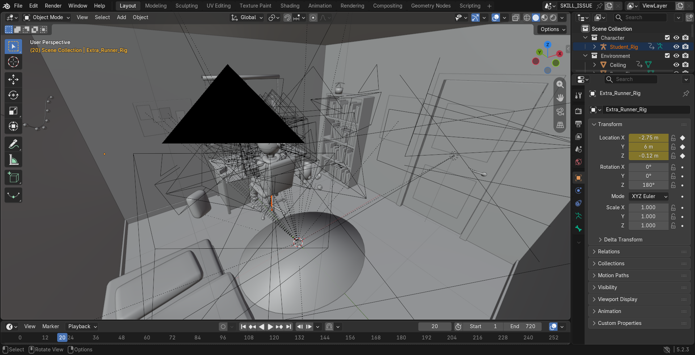
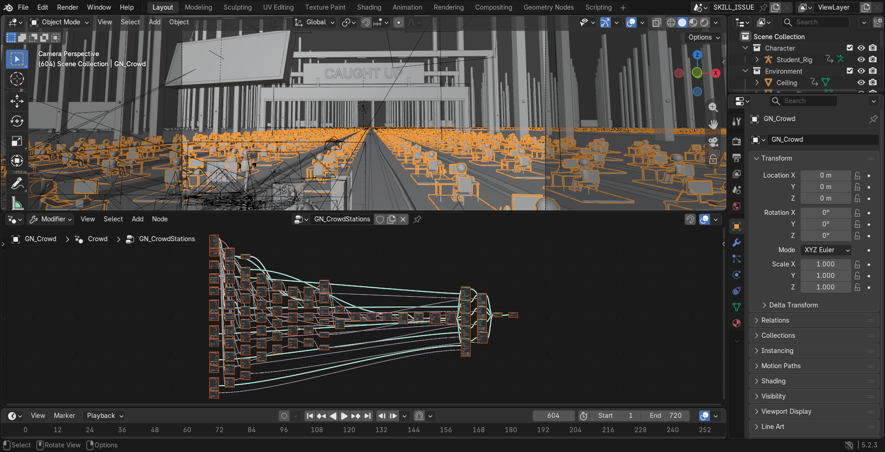
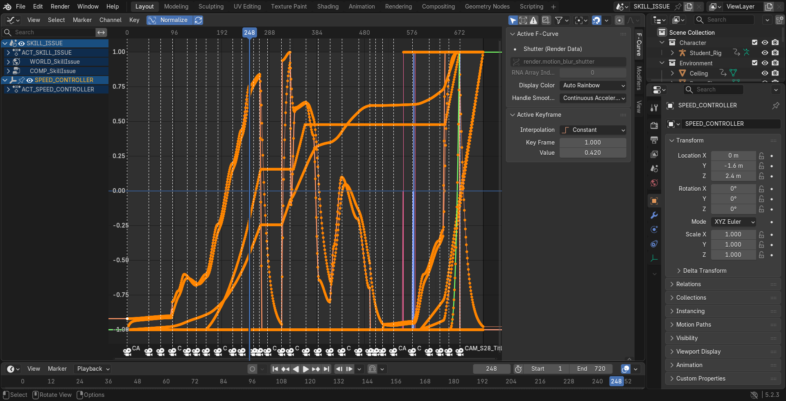
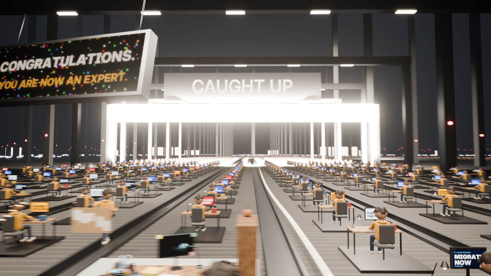

# SKILL ISSUE

*A 30-second dark comedy about the race to keep up with AI.*

A university student tries to learn AI faster than AI can change. Every notification
creates another urgent skill. He types faster, watches tutorials at 16x, builds an AI agent
to learn for him and gets a personalised roadmap of **847 skills**, which is obsolete before
he finishes his coffee. So he gives up, closes the laptop and walks to the door, at peace for
the first time. *"Finally. I'm caught up."* He turns the handle, the walls of his bedroom fall
flat, and he's standing on a conveyor belt among thousands of identical students, all chasing
a glowing finish line called **CAUGHT UP** that moves away faster than any of them can follow.

**HUMANITY: STILL IN BETA.**

Made in Blender for the [RenderJuice Blender Animation & Programmatic Rendering Contest](https://www.renderjuice.com/contests/speed).
Creator: **Bilal Feroz**.

## Watch

- **Final film:** [`renders/skill_issue_final.mp4`](renders/skill_issue_final.mp4)
  (1920×1080, 24 fps, 30.0 s, H.264 + AAC stereo)
- Low-res animatic used for timing review: [`renders/skill_issue_animatic_v1.mp4`](renders/skill_issue_animatic_v1.mp4)

| Spec | Value |
|---|---|
| Runtime | 30.000 s (720 frames, 1–720) |
| Resolution / rate | 1920 × 1080, 24 fps, 16:9 |
| Engine | Blender 5.2.3 LTS, EEVEE (ray-traced screen-space GI/reflections, motion blur), 48 spp |
| Audio | Original procedural score + SFX, 48 kHz stereo, −15 LUFS |
| Shots | 29 (see [`docs/creative_direction.md`](docs/creative_direction.md)) |
| Hardware | RTX 3050 Laptop 4 GB, Ryzen 7 7435HS, ~5–6 s per final frame |

## Interpretation of speed

Technology accelerates, and the people inside it are told to accelerate too. The film never
makes AI the villain. The student keeps building his own treadmill: *LEARN AI* becomes
*LEARN AI FASTER*, then a machine that automates learning and prints an obsolete roadmap.
The last shot shows the treadmill is a system. His bedroom is a stage set on a looping
conveyor, one of thousands, and the finish line is engineered to recede faster than the
people chasing it. **Speed also drives the code:** one normalised speed curve controls the
typing, the clock, the clutter, the music tempo, the light pulses, the camera shake, the
conveyor belts and the finish line.

## Procedural architecture

The whole film is built and animated by code. `blender -b --factory-startup -P scripts/build_scene.py`
recreates `project/skill_issue.blend` from nothing in about 6 seconds.

```
timeline.py ──► speed.py (SPEED controller: per-frame channels + spawn events, seeded)
     │               │
     │               ├──► Blender: SPEED_CONTROLLER empty (custom props, baked per frame)
     │               │       ├─ drivers ─► GN_Crowd (Belt Distance, Typing Phase), belt material scroll,
     │               │       │             eye-bag "Stress" shader value
     │               │       └─ animate.py ─► typing taps, clock, clutter spawns, machine, lights,
     │               │                        finish-line recession, handheld camera, motion-blur shutter
     │               ├──► generate_screens.py ─► laptop / monitor / notebook / stadium display sequences
     │               ├──► generate_clock.py   ─► desk clock digits (from the clock channel)
     │               └──► generate_audio.py   ─► music tempo + beat grid, key clicks, dings, thumps
     └──► every beat frame (notifications, punchlines, sync points) for all of the above
```

**The speed system** (`scripts/skill_issue/speed.py`). `speed(f)` is a 0..1 curve with four
phases: a slow opening, an escalating middle, dead stops on the punchlines (frames 273 and
492), and an explosive ending. Each consumer gets a different response curve, lag and offset,
so things accelerate together without moving in lockstep:

| Channel | Response | Drives |
|---|---|---|
| `typing_rate` / `typing_phase` | 2 + 15·s^1.35 taps/s, integrated | Hero finger taps, nervous heel bounce, build-montage hands |
| `crowd_typing_phase` | 3 + 9·s^1.1, +14 after "10X" | GN crowd arm rotation + head nods |
| `clock_minutes` | real time + 16·s^2.6 min/frame | Desk clock digits; the window dawn |
| spawn accumulators | 7·s^1.5 books/s, 4.2·s² cups/s, 2.6·s^1.2 papers/s, 5·s^1.3 toasts/s | Books dropping onto towers, cups popping in, papers sliding, mini notifications, matching thumps/clinks/ticks |
| `cam_intensity` | one-pole low-pass (fast attack, slow release) | Handheld camera noise amplitude |
| `light_pulse` | decaying impulse per notification | Laptop/monitor spill light energy |
| `tempo_bpm` / beat grid | 84 + 96·s^0.9 BPM, integrated | Music rhythm layer, machine core pulse |
| `belt_speed` / `belt_distance` | 0.5 + 3·s m/s, +22 m/s at "10X" | GN station positions along the belts, belt texture scroll, hero station + extras riding the belt |
| `finish_gap` | 6 + 1.4·v m/s (always faster than the belt) | CAUGHT UP gate receding along the analytic track |
| `stress` | integral of s^1.2 (never recovers) | Eye bags (shader), messy hair (shape key), heavier eyelids, slumping posture |

**Repeated environments.** `GN_CrowdStations` (Geometry Nodes) places
11 lanes × 297 stations along a cyclic centre-line curve of an analytic oval track
(`track.py`). Arc length = slot · spacing + **Belt Distance** + lane stagger; position and
tangent come from *Sample Curve* plus a lateral lane offset. It deletes the hero's slot and
instances a desk set, the clone's body, two separately rotated typing arms and a nodding head.
Each screen picks one of 16 announcement tiles through a per-instance `tile` attribute.
`GN_FarLoopField` repeats the system across a 5×5 grid of loops (24 more), each with its own
unreachable finish glow. Columns are linked collection instances.

**Character and acting.** `character.py` builds the student: an armature with analytically
weighted deforming meshes, a shape-keyed mouth projected onto the head surface, procedural
eyes and lids, and hair with *Messy* and *Blown* shape keys. A `rest_co` attribute keeps
textures stuck to the deforming surface. `puppet.py` is a pose solver with analytic two-bone
IK for arms and legs plus FK for the spine. `animate.py` describes the performance as
pose-to-pose keys on world-space targets (keyboard, mug, button, door handle, hips), blended,
layered with procedural motion and baked into ordinary bone keyframes.

**Manually authored vs. procedural.** Authored as code data: the shot list, beat frames, pose
keys, camera paths and lens choices, and the set layout. Procedural: everything in the speed
table above, plus the machine assembly and activation, the paper scroll growth, the walls
falling, the crowd, the far loops, finish-line motion, blinks, saccades, breathing and handheld
noise. Deterministic seeds are set in `speed.py` (SEED = 72024), `room.py`, `hall.py`,
`machine.py`, `character.py` and the screen and audio generators.

## Repository layout

```
project/skill_issue.blend        the saved Blender project (rebuilt by build_scene.py)
scripts/build_scene.py           entry point: builds and animates the whole film
scripts/skill_issue/             timeline, speed controller, character, puppet (IK), room, machine,
                                 track, hall (GN), animate (performance), cameras, lighting, render_setup
scripts/generate_screens.py      screen graphics (Pillow)        scripts/generate_audio.py  soundtrack (numpy)
scripts/generate_clock.py        clock digits                    scripts/generate_captions.py  whisper caption
scripts/render_frames.py         resumable renderer              scripts/assemble_video.py  FFmpeg mux
scripts/validate_project.py      deliverable checks              scripts/capture_evidence.py  WIP screenshots
scripts/contact_sheet.py         frame contact sheets for review
assets/  audio/  renders/  evidence/  docs/
```

The brief suggested `animate_scene.py`, `procedural_systems.py` and `configure_render.py`;
those roles live in `skill_issue/animate.py`, `skill_issue/speed.py` + `skill_issue/hall.py`,
and `skill_issue/render_setup.py`.

## Open, rebuild, render

Requirements: **Blender 5.2** (built and tested on 5.2.3 LTS; older versions won't work because
the Geometry Nodes and animation APIs changed), Python 3.10+ with `pip install -r requirements.txt`
(Pillow, numpy), and FFmpeg on PATH. The voice lines are cached, so Windows TTS is only needed
for `--retts`.

```bash
# open the project as-is (all screen textures are in assets/screens, paths are relative)
blender project/skill_issue.blend
```

```bash
# or reproduce everything end to end (assets -> build -> render -> MP4 -> validation)
python scripts/run_pipeline.py --blender "C:/Program Files/Blender Foundation/Blender 5.2/blender.exe"
```

Step by step:

```bash
# regenerate assets from the timeline (deterministic)
python scripts/generate_screens.py
```

```bash
python scripts/generate_clock.py
```

```bash
python scripts/generate_captions.py
```

```bash
python scripts/generate_audio.py
```

```bash
# rebuild the .blend from code
blender -b --factory-startup -P scripts/build_scene.py -- --preset final
```

```bash
# render (resumable: rerun to continue an interrupted render)
blender -b project/skill_issue.blend -P scripts/render_frames.py -- --preset final --frames 1-720
```

```bash
# mux and validate
python scripts/assemble_video.py
```

```bash
python scripts/validate_project.py --frames renders/frames
```

Presets: `draft` (25 %, 4 spp), `preview` (50 %, 12 spp), `final` (100 %, 48 spp, motion blur, ray tracing).
To change the film, edit beat frames in `scripts/skill_issue/timeline.py` or the curve in
`speed.py`, then re-run the generators and the build. Picture, screens and sound stay in sync.

## Work-in-progress evidence

Genuine captures of the real Blender 5.2.3 UI and renders, taken during production
(see [`evidence/README.md`](evidence/README.md)):

| | |
|---|---|
|  |  |
| 01: scene layout (solid view) | 03: `GN_CrowdStations` node tree + instanced crowd |
|  |  |
| 05: SPEED_CONTROLLER channels + camera markers | 04: final render of the industrial reveal |

## Disclosures

No third-party 3D assets, textures, music or sound libraries were used. No generative image,
video, 3D or music models were used. The project was produced with an AI coding agent
(Claude by Anthropic, in Claude Code), which wrote the code that builds every asset. The two
short voice lines are Windows' built-in offline text-to-speech, heavily processed. Fonts are
Inter (OFL) and DejaVu Sans Mono (Bitstream Vera license), both bundled with Blender. Full
table: [`docs/asset_disclosures.md`](docs/asset_disclosures.md).

## Contest status

Prepared for the RenderJuice *Blender Animation & Programmatic Rendering* contest
(theme: **speed**). **It hasn't been submitted.** Official entry requires a RenderJuice
account, joining the contest through its Discord and posting in the submission channel, all of
which the creator does personally. Submission materials (video, interpretation, WIP image,
disclosures, workflow notes) are in this repository.

## License

Code: MIT. Film, project file, generated graphics and audio: CC BY 4.0. See [`LICENSE`](LICENSE).
